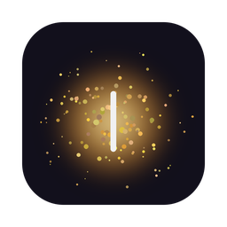
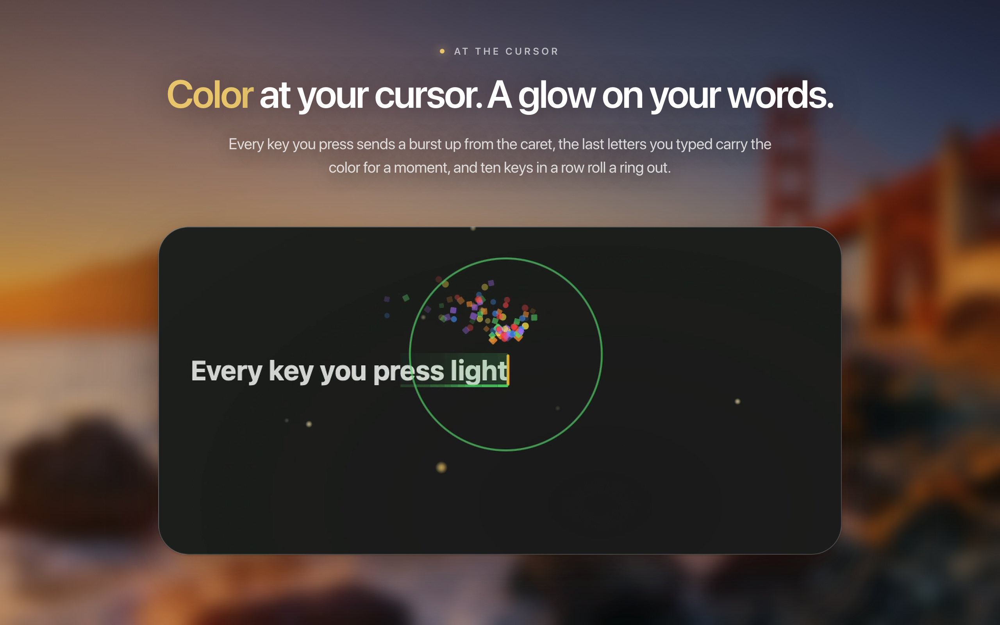
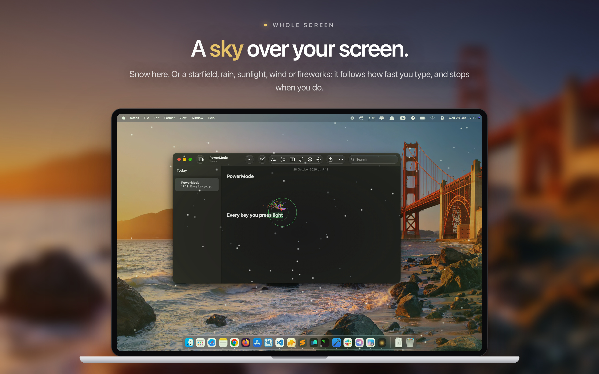
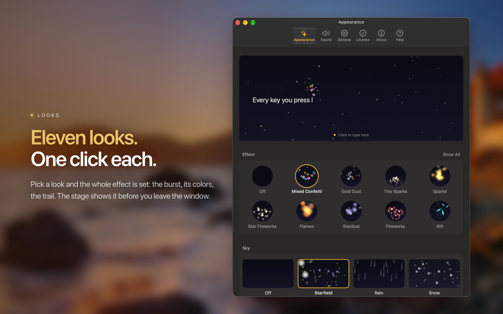
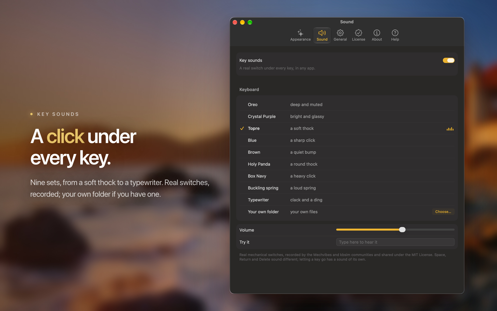
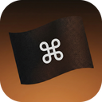

  

<h1 align="center">PowerMode</h1>

<h3 align="center">
  Color at your cursor, a glow on your words, 
  a sky over your screen, a click under every key.
</h3>

  
  
  
  

 

<h4 align="center">
  <u>This repository hosts the public issue &amp; feature tracker for PowerMode.</u>
</h4>

  Get PowerMode at
  <a href="https://powermode.app"><strong>powermode.app</strong></a>.

 

Type anywhere on your Mac and a burst of color rises from the cursor. The
last letters you typed glow, a sky can fill your screen, and every key can
click. Pick one of eleven looks and the whole effect is set: the burst, its
colors, the trail. One click in the menu bar, done.

PowerMode is a native macOS menu bar app, and it works in any app you type
in: Notes, TextEdit, Mail, Safari, Xcode, Chrome, VS Code, Slack. In apps that
hide their cursor, such as terminals, the sky and the sounds still follow
every key. When you stop, PowerMode stops: nothing on screen and no CPU.

 

## A glow on your words

Every key sends a burst up from the cursor. The last letters you typed carry
the look's color, as an underline or a soft glow, fading toward the older ones
and gone about a second after you stop. Backspace removes the newest, Return
sweeps the trail out, and every ten letters the color moves on to the next in
the look's wheel.

Keep typing and PowerMode notices. At **10, 25, 50 and 100 keys in a row** the
colors change, a ring and a flash land at the cursor, and the sky fires its own
volley. A streak starts over when you move to another app or field, or press a
shortcut or an arrow key, so milestones land where you expect them.

 

## A sky over your screen

Turn on a sky and the display you type on joins in. **Starfield, Rain, Snow,
Sunlight, Wind or Fireworks** fills the screen, grows with your typing speed,
and clears within seconds of your last key. Or let _Match the effect_ pick two
skies that suit your look and take turns.

A switch under Sky dims every other window while you type, from the first key
until the streak ends. Reduce Motion turns the sky off and switches every look
to its Calm variant.

 

## Eleven looks. One click each.

**Mixed Confetti** (the default), Circle Confetti, Square Confetti, Sparks,
Tiny Sparks, Fireworks, Star Fireworks, Flames, Rift, Stardust and Gold Dust.
Every one is a complete effect. Pick it from the menu bar or from
**Settings ▸ Appearance**, where a stage types a sentence by itself with your
choices; click it and type yourself.

Intensity has Calm, Normal and Strong. _Colorful_ cycles the look's own colors
as you type; _One color_ keeps one, from nine swatches or any color you pick,
on the burst, the trail and the milestone ring together.

 

## A click under every key

Nine sets: **Oreo, Crystal Purple, Topre, Blue, Brown, Holy Panda, Box Navy
and Buckling spring**, recorded from real mechanical switches by the Mechvibes
and kbsim communities (MIT, credited in About), plus a synthesized
**Typewriter**, or a folder of your own WAV files.

Played per keyboard row in stereo. Space, Return and Delete sound different,
letting a key go has a sound of its own, and a held key clicks once. Picking a
set plays it; a volume slider and a line to try your own keys sit under the
list.

 

## From the menu bar

A keycap wearing sunglasses; its legend carries the state. One click opens a
menu that names your effect, sky and sound set, each with a submenu to change
it (the looks with thumbnails). Pause for 30 minutes, an hour, the rest of
today or until you turn it back on, or pause in the app in front. PowerMode
comes back on its own, after a sleep or a relaunch too.

 

## Where the burst lands

| App                                                                     | Burst                                                                                                 |
| ----------------------------------------------------------------------- | ----------------------------------------------------------------------------------------------------- |
| Notes, TextEdit, Mail, Safari, Xcode                                    | at the cursor                                                                                         |
| Chrome, Brave, Edge, Vivaldi, Arc                                       | at the cursor with _Follow my typing in Chrome_ on (the default)                                      |
| VS Code, Slack and other Electron apps                                  | at the cursor once the app has exposed its text, about a second after the first key                   |
| Terminal, Warp, Ghostty, Sublime Text, games, any app that hides its cursor | no burst and no trail; the milestones, the sky and the sounds still follow every key              |
| A password field, a `sudo` prompt, a locked screen                      | nothing                                                                                               |

 

## Private by design

PowerMode counts keystrokes; it never reads what you type. **No account, no
analytics, no telemetry.**

- **It asks macOS where the cursor is, never what is around it.** Per key it
  reads the focused element's role and the rectangle of its caret. The text
  itself is never requested, and the key code and the character are dropped
  inside the event handler, never stored or logged.
- **Nothing is drawn or played while keyboard input is private**: a password
  field, a `sudo` prompt, a locked screen, or an app you paused. Keys taken by
  Spotlight or a launcher draw and play nothing either.
- **One permission, Accessibility**, asked once during setup. No Input
  Monitoring, no Screen Recording.
- **One network destination.** The build from powermode.app sends your license
  key, and nothing else, to Gumroad to verify it on activation and every seven
  days. The key lives in the Keychain, never in a preferences file or a log.
  Nothing else is ever contacted.
- **Logs are redacted at the source.** Never a key code, a character or any
  text. They live in memory for the current launch and reach disk only when
  you export one yourself.

Full details in the [privacy policy](https://powermode.app/privacy-policy).

 

## Requirements

- **macOS 14** or later — Universal (Apple silicon & Intel)
- **Accessibility** permission, the one PowerMode asks for during setup

 

## Where to look

| Place                                                         | What's in it                                                             |
| ------------------------------------------------------------- | ------------------------------------------------------------------------ |
| **Settings ▸ Help** in the app                                | Replay the welcome guide, where the light lands, milestones, pausing, export a log |
| [Changelog](https://powermode.app/changelog)                  | What changed in each release                                             |
| [Privacy policy](https://powermode.app/privacy-policy)        | What is read on each key, and what never is                              |
| [Contact](https://powermode.app/contact)                      | Purchases, licenses, and anything you'd rather not post publicly         |

 

## Found a bug? Missing a feature?

That is exactly what this repository is for.

- 🐞 [**Report a bug**](https://github.com/theblackflagger/PowerMode/issues/new?template=1-bug-report.yml) — the form asks for the few details that make a report actionable
- ✨ [**Request a feature**](https://github.com/theblackflagger/PowerMode/issues/new?template=2-feature-request.yml)
- ❓ [**Ask a question**](https://github.com/theblackflagger/PowerMode/issues/new?template=3-question.yml)

Please [search the existing issues](https://github.com/theblackflagger/PowerMode/issues?q=is%3Aissue)
first — and for anything about a purchase, a license, or a security report, use
the [contact page](https://powermode.app/contact) rather than a public issue.

 
 

  
  Built by <a href="https://theblackflagger.com">The Black Flagger</a> ·
  <a href="https://powermode.app">powermode.app</a> ·
  <a href="https://tintrungnguyen.com">tintrungnguyen.com</a>

  
  
  

